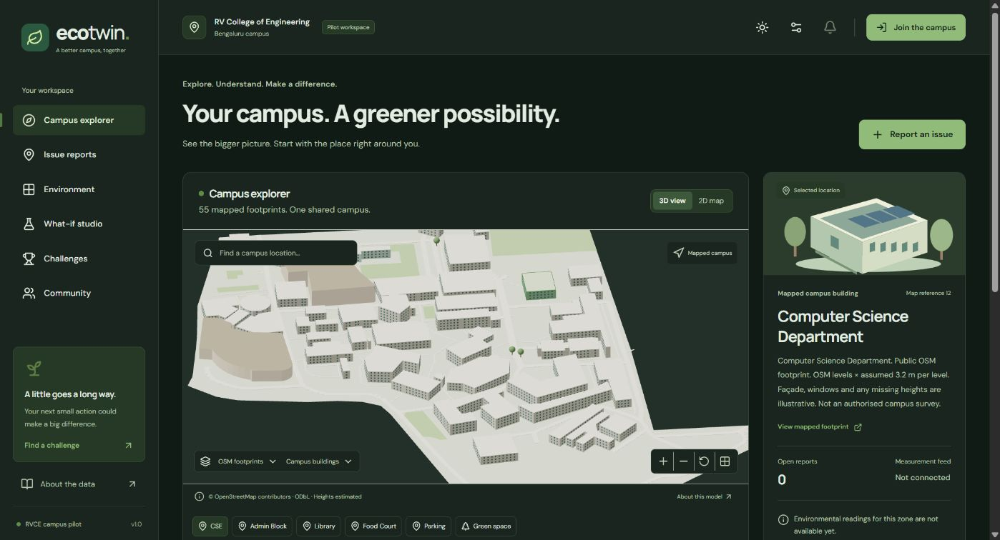

# ECO-TWIN

An environmental digital twin for RV College of Engineering, Bengaluru, built with React, Three.js and Django.

ECO-TWIN provides an interactive campus map, photo-based issue reporting, moderator review and waste, water and energy scenario calculations.



## Features

| Module | Functionality |
| --- | --- |
| Campus explorer | Geographic 3D model, keyboard-accessible 2D map, location search, layers and camera controls |
| Issue reporting | Photo uploads, campus zones, optional GPS coordinates and status history |
| Moderation | Verification, assignment, progress tracking, resolution and rejection |
| Scenario analysis | Waste, electricity and water reductions, chart comparisons, saved scenarios and JSON export |
| Challenges | Participation, evidence submission, moderator review, points and badges |
| Community | Location-based suggestions and support votes |
| Display settings | Light/dark/system themes, three accent colors, layout density, text size, reduced motion and low-power rendering |

Report verification awards 10 points through a unique reward record. Accounts, reports, reviews and scenarios persist in the backend database. Display preferences are stored in the browser.

## Architecture

| Layer | Implementation |
| --- | --- |
| Frontend | React 19, TypeScript, Vite, React Router |
| Rendering | Three.js, React Three Fiber, Drei |
| Charts | Chart.js |
| Components | Radix Dialog, Lucide icons |
| API | Django 5.2, Django REST Framework |
| Database | SQLite; optional PostgreSQL configuration |
| Static assets | WhiteNoise |

Vite proxies API requests to Django during development. A production frontend build can also be served by Django. The renderer uses on-demand frames, merged road geometry and instanced windows.

## Development setup

### Requirements

- Node.js 24
- Python 3.13
- Git

### Installation

```powershell
git clone https://github.com/kushalarvindo/Eco-Twin.git
cd Eco-Twin

npm ci
python -m venv .venv
.\.venv\Scripts\python.exe -m pip install -r backend/requirements.txt
.\.venv\Scripts\python.exe backend/manage.py migrate
.\.venv\Scripts\python.exe backend/manage.py seed
```

### Start the application

Run the backend and frontend in separate terminals from the project root.

**Backend**

```powershell
.\.venv\Scripts\python.exe backend/manage.py runserver 127.0.0.1:8000 --noreload
```

**Frontend**

```powershell
npm run dev
```

Open [localhost:5173](http://127.0.0.1:5173/). The API runs on port 8000. Stop either process with Ctrl+C.

On macOS and Linux, replace the Windows Python executable with `.venv/bin/python`.

The Windows helper `./Start-EcoTwin.ps1 -Demo` starts both services and checks their availability. If a port is occupied, use the existing service or select another port. Frontend port changes require a matching `DJANGO_CSRF_ORIGINS` entry; backend port changes require updating the proxy in `vite.config.ts`.

### Demo accounts

To create local member and moderator accounts:

```powershell
.\.venv\Scripts\python.exe backend/manage.py seed --demo
```

| Role | Username |
| --- | --- |
| Member | `student` |
| Moderator | `moderator` |

The generated password is stored in `.local/demo-password.txt`. Existing account passwords are preserved when the command is repeated. Demo seeding is available only in DEBUG mode. Registration through the application creates member accounts.

## Commands

| Command | Purpose |
| --- | --- |
| `npm run check` | TypeScript validation |
| `npm run build` | Generate the frontend build in `dist/` |
| `npm test` | Run the Django test suite |
| `npm run format` | Format frontend source files |

After `npm run build`, Django serves the compiled application at [localhost:8000](http://127.0.0.1:8000/).

The backend suite covers calculations, authentication, CSRF, report visibility, upload validation, moderation transitions, reward uniqueness, scenario ownership, challenge review and voting. See [Testing](docs/QA.md) for results and browser coverage.

## Campus model and data

The geographic dataset contains 55 building footprints, 143 road/path features, 11 open/green polygons and 4 mapped tree points. A separate historical event-map view contains 28 numbered references and one virtual study area.

Building outlines are derived from OpenStreetMap. Heights use mapped values when available, mapped floor counts × 3.2 m otherwise, and a 9.6 m fallback. Facades, windows and roofs are approximate. The model does not include surveyed interiors or a complete tree inventory.

Campus infrastructure data consists of 37 source-linked records. Published capacities retain their source dates and conflict notes. Live environmental telemetry is not connected.

Scenario calculations apply a linear reduction to the supplied baseline:

```text
scenario = baseline × (1 − reduction / 100)
```

Results describe the selected assumptions. They are not calibrated forecasts. See [Campus geometry](docs/GEOMETRY.md) for data sources, coordinate systems and modelling details.

## Repository structure

```text
frontend/src/       UI, themes, campus datasets and scene components
backend/config/    Django configuration and URL routing
backend/core/      Models, API, calculations, migrations and tests
RVCE Research/data/facts.json
                   Campus records and source references
scripts/           Development and data-processing utilities
docs/              Geometry specification and test results
public/            Static assets
```

## Configuration

Django reads process environment variables. The supported settings are listed in `.env.example`.

| Variable | Purpose |
| --- | --- |
| `DJANGO_DEBUG` | Development mode; set to `0` for deployment |
| `DJANGO_SECRET_KEY` | Django signing key; required in production |
| `DJANGO_ALLOWED_HOSTS` | Allowed hostnames, comma-separated |
| `DJANGO_CSRF_ORIGINS` | Trusted request origins, comma-separated |
| `MEDIA_ROOT` | Persistent upload directory |
| `POSTGRES_DB`, `POSTGRES_USER`, `POSTGRES_PASSWORD`, `POSTGRES_HOST`, `POSTGRES_PORT` | PostgreSQL connection settings |

The default development database is SQLite. PostgreSQL configuration is available; production PostgreSQL/PostGIS integration has not been validated.

Deployment requires a Python WSGI server, HTTPS and persistent database/media storage. Build the frontend, apply migrations and seed without demo accounts. The application has not been deployed to a hosted environment.

Authentication and upload handling are documented in [SECURITY.md](SECURITY.md).

## Attribution

Campus geometry: © OpenStreetMap contributors, licensed under the [Open Database License](https://www.openstreetmap.org/copyright). Source identifiers and links are included in the derived dataset.

Institutional records link to their original sources. The historical map remains the property of its original publisher.

## Campus references and scenario templates

The geographic explorer displays building names on hover and selection, estimated footprint areas and height provenance. Nearby Street View opens in Google Maps; coverage depends on the location. The administration detail includes a historical photograph by [Rvian00 (2009)](https://commons.wikimedia.org/wiki/File:RV_College_Admin_block.JPG), licensed under [CC BY-SA 3.0](https://creativecommons.org/licenses/by-sa/3.0/), displayed with CSS cropping.

Six editable templates cover waste segregation, composting, lighting, equipment shutdown, leaks and efficient water fixtures. Saved scenarios can be copied into variants. Monthly and annual projections assume constant daily inputs. Template percentages are examples, not measured intervention performance.

In **Campus explorer → Campus layer**, choose footprint area, estimated height, or open reports (all categories, waste, water or energy). Both maps use the same four color bands. The legend shows the number of buildings in each band and the three highest positive values. Report layers count records assigned to mapped buildings across all reports visible to the current user that were opened during the selected period.

### Reports and electricity records

The report period applies to both campus maps and the selected building. The weekly chart counts submissions by creation date and resolutions by status-change date, in campus local time. Older submissions can contribute a resolution in the selected period. The Environment page lists the geometry and photo sources for each building. The What-if studio compares up to three saved scenarios with compatible units.

To load an authorised electricity log, run migrations and import a CSV from the project root using the project Python environment:

```sh
python backend/manage.py migrate
python backend/manage.py import_electricity path/to/readings.csv
```

Use the header `zone,meter,timestamp,unit,kind,value,source`. The zone is the building ID. Supply a public-safe meter label and source description as both appear on the dashboard. Use `kWh` and a campus-midnight ISO timestamp with UTC offset (for example `2026-10-02T00:00:00+05:30`). A `daily` value is consumption during the preceding day. A `cumulative` value is the meter register at midnight. The chart derives consumption from consecutive register readings, leaves missing intervals and resets blank, and preserves measured zeroes. It shows the latest 30 days for each meter and the number of days included in each weekly sum. Reimporting identical readings is safe. A conflicting reading rolls back the whole file. Keep original logs outside the repository.
